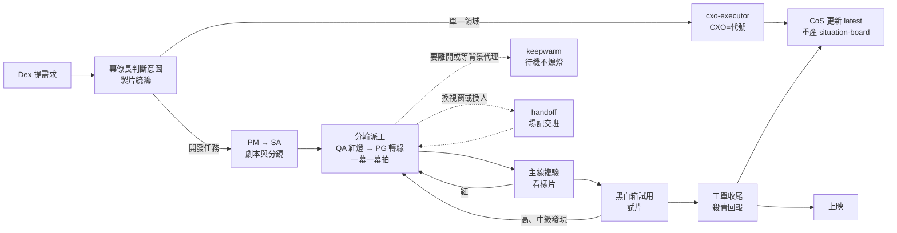

# directing-with-claude-code：用導電影的方式寫程式

這是 Dex（DayDreamDex）日常用 Claude Code 工作的一整套做法：一位「幕僚長」負責派工，四個角色接力開發，主線負責分輪派工與複驗，找 AI 測試員試用畫面，確認後回報工單交件；中途要離開就保溫，要換手就寫交接檔。

給 AI 的指令維持原本的工程語言（PM、SA、SDD、BDD、Given/When/Then），因為那是 AI 聽得懂、執行力最好的說法。我們只在旁邊加一層「這一步在拍電影是哪個步驟」，讓沒有程式背景的人也跟得上。

這個 repo 有兩類內容：一類是 Dex 自己做的（AGPL-3.0 授權）；另一類由公司團隊的做法調整、重寫而成，用來說明整套工作流程，不在 AGPL-3.0 授權範圍內。哪些屬於哪一類，見文末〈授權〉與 `NOTICE.md`。

> 先寫劇本 → 再畫分鏡 → 開拍 → 每天看樣片 → 重拍修正 → 剪輯上映

## 工程步驟 ↔ 拍電影

| 工程流程 | 拍電影對照 |
|---|---|
| 定義需求／規格（SDD） | 劇本大綱（Treatment） |
| 寫情境驗收（BDD） | 分鏡腳本（Storyboard） |
| 規劃專案架構 | 場景搭建＋美術設計 |
| 切小任務、逐步實作 | 一幕一幕拍（Scene by Scene） |
| 測試／驗收 | 試片（Screening） |
| Debug／修正 | 重拍（Reshoot） |
| 重構／整理 | 剪輯（Editing） |
| Release／文件 | 上映＋觀眾指南（Press Kit） |

## 每一塊在劇組裡是哪個位置

| 資料夾 | 做什麼 | 劇組裡的位置 |
|---|---|---|
| [`chief-of-staff/`](chief-of-staff/) | 幕僚長（CoS）判斷意圖，派給對應的 CXO（行銷、產品、教學、技術…）；各 CXO 的現況寫回固定格式的 context 檔，再自動彙整成一張全局看板 | 製片統籌：排通告、分派各組；/board 是製作會議 |
| [`four-agent-flow/`](four-agent-flow/) | PM → SA → PG → QA 四個代理接力，從需求文件走到測試報告 | PM＝劇本大綱與分鏡腳本；SA＝場景搭建＋美術設計；PG＝一幕一幕拍；QA＝試片 |
| [`dispatch-round/`](dispatch-round/) | 主線寫派工單、子代理一輪做一件事，主線自己跑建置與測試複驗，結論另派代理專門推翻 | 派工單＝拍攝通告；主線複驗＝看樣片；修正輪＝重拍；對抗輪＝專挑穿幫鏡頭的人 |
| [`ux-blackbox-trial/`](ux-blackbox-trial/) | 派多位 AI 測試員照任務操作畫面，白箱檢查員對照規範，協調窗逐條核對後出報告 | 試片：找沒讀過劇本的人先看；雛形關＝毛片試映 |
| [`work-item-ops/`](work-item-ops/) | 案子做完：工單留言說明、指派回負責人、改成待驗收；先預覽再寫入 | 殺青回報：這場拍完向製片回報、交回通告單 |
| [`handoff/`](handoff/) | HANDOFF 交接檔：一句話現況、等你拍板、下一步、坑；太長或換階段就封存、開新檔；新 session 用 `@HANDOFF.md` 帶入 | 場記交班：場記表記下這場拍到哪、哪顆鏡頭 OK，隔天接著拍 |
| [`keepwarm/`](keepwarm/) | 派背景代理或離開 1～8 小時時，定時喚醒主線，讓 prompt cache 不過期 | 待機不熄燈：收工前燈光、攝影機保持熱機 |
| [`rules/`](rules/) | 風險分級、測試、code review、開發文件範本、擋住「改測試換綠燈」的 hook | 拍攝規範 |
| [web-style-recipes](https://github.com/lu791019/web-style-recipes)（另一個公開 repo） | 實驗型互動首頁的風格配方 | 美術設計的參考本 |

## 一次派工怎麼走



文字版：

1. Dex 說要做什麼。幕僚長看意圖：單一領域的產出派 `cxo-executor`（prompt 第一行 `CXO=cmo` 這類代號）；只是討論就載入對應的 CXO skill；跨領域開 `/board`。
2. 開發任務走 PM → SA：需求文件 → 事件風暴 → 質詢輪 → Gherkin → 對到真實專案結構的技術規格。
3. 主線照 `dispatch-round` 分輪派工：QA 先寫會紅的測試，PG 只負責讓它轉綠（派工單第一行 `TESTS=locked`，hook 擋住改測試）。
4. 每輪主線自己跑建置與測試，不採信代理自報。會被後面依賴的結論，另派一個代理專門推翻。
5. 有新畫面或流程改動，交件前跑 `ux-blackbox-trial`；高、中級發現處理完才交。
6. 交件時用 `work-item-ops` 在工單留言、指派回負責人、改成待驗收（先預覽，同意才寫入）。
7. 代理回報後，幕僚長更新該 CXO 的 `*-latest.md`，跑 `scripts/build-situation-board.py` 重產全局看板。

過程中：要離開一段時間或在等背景代理，開 `keepwarm`；要換視窗、換人或換階段，寫 `handoff` 交接檔，下一個 session 用 `@HANDOFF.md` 帶入接著做。

## 給 AI 的七條指令（原文不改，旁邊是拍電影對照）

| # | 工程指令 | 拍電影對照 | 白話 |
|---|---|---|---|
| 1 | 你是我的資深工程師／架構師。你必須先讀完 docs 裡的規格和情境文件，才能開始開發。任何不確定都要先問，不准腦補。 | 讀本（table read，開拍前全體演員圍著把劇本讀過一遍）＋拍攝規範 | 不要 AI 即興演出，先把劇本讀完才准進片場。 |
| 2 | 先建立專案結構、基本頁面／路由、主要模組骨架。先產出可跑的第一版，不用一次做到所有細節。 | 搭景＋試拍 | 先把攝影棚搭好，看到能動的雛形，再補細節。 |
| 3 | 我們只做這個任務。請你只完成範圍內的內容，並確保可驗收，不要順便改其它地方。 | 今天只拍第 3 幕，不准加拍支線 | 通告只寫這一幕，拍完就收工，不擅自加戲。 |
| 4 | 請根據 BDD 的 Given/When/Then 情境，為這個功能補上對應的測試或驗收方式，確保情境能通過。 | 試片規格：觀眾在這一幕要看到什麼 | 不是「差不多」，是要符合分鏡的畫面。 |
| 5 | 這是我目前遇到的錯誤／現象（貼上）。請分析原因並提出最小修改修復，不要重寫整個系統。 | 導演筆記：重拍局部鏡頭 | 只補拍那個鏡頭，不把整場戲推倒重來。 |
| 6 | 請重構這段程式碼，提高可讀性與可維護性，但不能改變任何外部行為與功能結果。 | 剪輯：節奏更順，故事不能變 | 剪得更漂亮，不是改劇情。 |
| 7 | 請為這個專案補上 README，包含：如何啟動、如何使用、主要功能、限制、驗收方式。 | 觀眾指南＋新聞資料包 | 第一次看到的人也知道怎麼用、怎麼驗收。 |

## 目錄

```
.
├── chief-of-staff/
│   ├── CLAUDE.cos-example.md      幕僚長規則（貼進你的 CLAUDE.md）
│   ├── agents/cxo-executor.md     CXO 執行者（放 ~/.claude/agents/）
│   ├── cxo-skills/                各 CXO 的 SKILL.md 與 persona（放 ~/.claude/skills/）
│   ├── knowledge/cos-playbook.md  派工與 context 管理手冊
│   ├── state/                     角色名冊、各 CXO 的 latest（範本）、situation-board（範本）
│   ├── scripts/build-situation-board.py
│   └── tests/
├── four-agent-flow/               PM／SA／PG／QA 四代理與三份流程 skill
├── dispatch-round/                分輪派工 skill（含 risk_paths、check_ownership、cost-scan 腳本與測試）
├── ux-blackbox-trial/             黑白箱試用 skill（含 scaffold、audit 腳本）
├── work-item-ops/                 工單收尾 skill（含 work_item.py 與測試）
├── handoff/                       HANDOFF 交接檔規則與範本
├── keepwarm/                      快取保溫 skill
├── LICENSE                        AGPL-3.0（適用範圍見檔頭）
├── NOTICE.md                      兩類內容與授權範圍
└── rules/                         testing、code-review、agents 規則；開發文件範本；test-edit-guard hook
```

## 怎麼裝到自己的 Claude Code

> 下面第 2、3 步提到的 `four-agent-flow/`、`dispatch-round/`、`ux-blackbox-trial/`、`keepwarm/` 不在 AGPL-3.0 授權範圍內，僅供閱讀參考；要再利用請先取得原團隊同意（見〈授權〉）。

1. **幕僚長**：把 `chief-of-staff/` 複製成 `~/daydreamdex/`（檔案裡的路徑都寫 `~/daydreamdex/`，要放別處就整批取代）。
   - `cxo-skills/daydreamdex-*` 放進 `~/.claude/skills/`，`agents/cxo-executor.md` 放進 `~/.claude/agents/`。
   - `CLAUDE.cos-example.md` 的內容貼進 `~/CLAUDE.md`。
   - 自己補 `knowledge/direction.md`（事業方向）與各 `knowledge/{cxo}/` 知識庫，這些沒有收錄。
   - 試跑看板：`cd ~/daydreamdex && python3 scripts/build-situation-board.py --dry-run`；測試：`python3 -m unittest tests/test_build_situation_board.py`。
2. **四代理**：`four-agent-flow/agents/*.md` 放 `~/.claude/agents/`，`four-agent-flow/skills/*` 放 `~/.claude/skills/`。專案根目錄寫一份 `PROJECT_PROFILE.md`（技術棧、測試指令、產物放哪、名詞表）。
3. **分輪派工、黑白箱試用、工單收尾、交接、保溫**：各自整個資料夾放 `~/.claude/skills/`。工單收尾需要 `gh` CLI 並已登入。`dispatch-round/scripts/risk_paths.py` 可以連到 `~/bin/risk-paths` 當指令用。
4. **規則**：`rules/*.md` 放 `~/.claude/rules/common/`；`rules/templates/` 放 `~/.claude/templates/`；`rules/hooks/test-edit-guard.sh` 放 `~/.claude/hooks/`，並在 `settings.json` 掛成 PreToolUse（matcher `Write|Edit|NotebookEdit`）。需要 `jq`。

## 哪些是範本

- `chief-of-staff/state/cxo-context/*-latest.md` 與 `state/situation-board.md`：**內容是虛構的範本**，欄位與真實使用的檔一樣，條目用練功房、散場誌、部落格三個公開產品舉例。situation-board 的 BEGIN／END 之間是腳本用範本資料產生的。
- `ux-blackbox-trial/assets/*.json`：範例設定。
- `rules/templates/`：開發文件與 REVIEW.md 範本。

## 沒有收錄的

各 CXO 的知識庫與事業方向文件、決策歷史（archive）、董事會紀錄、檔案寫入紀錄 hook、名冊一致性檢查腳本（`cxo-lint.py`），以及流程裡引用的 `grill-me`、`no-hallucination`、`spec-html`、`uat-report`、`challenge-round`、`writing-round` 等 skill。檔案裡提到它們時，照文字描述的原則手動做即可。

## 出處

**Dex 自己做的**
- 拍電影對照與本 README 的教學內容、幕僚長（`chief-of-staff/`）、規則（`rules/`）。
- 交接（`handoff/`）：交接檔的寫法是 Dex 從自己多個專案的交接檔整理出來的；「用交接檔取代續接對話」的做法參考了工作上團隊的經驗。
- 工單收尾（`work-item-ops/`）：概念來自團隊的工單流程，這裡是重新寫的通用版。

**整理自工作上團隊的工具包**
- 四代理流程（`four-agent-flow/`）：流程構想來自工作上同事的設計，這裡是 Dex 移植到 Python 專案後、用自己的說法重寫的版本。
- 分輪派工（`dispatch-round/`）、黑白箱試用（`ux-blackbox-trial/`）、保溫（`keepwarm/`）：方法整理自工作上團隊的工具包，這裡是 Dex 為了說明自己的工作流程而重寫的介紹版。

**引用的公開資料**
- `dispatch-round/references/hill-climb.md` 的爬分做法參考 Felix Rieseberg〈Made by mechanical means〉；`rules/code-review.md` 參考 Anthropic〈Solving code review at Anthropic〉；`ux-blackbox-trial` 的走查清單來自 Nielsen 十項啟發式。

## 授權

- **AGPL-3.0（`LICENSE`，Copyright (C) 2026 DayDreamDex）**：只適用於 Dex 自己做的部分——本 README 的對照與教學、`chief-of-staff/`、`handoff/`、`work-item-ops/`、`rules/`（`rules/agents.md` 除外）。
- **不在 AGPL-3.0 範圍內**：`four-agent-flow/`、`dispatch-round/`、`ux-blackbox-trial/`、`keepwarm/`。這些資料夾的內容由作者參考公司團隊的做法調整、重寫而成，僅供閱讀參考；要再利用請先取得原團隊同意。各資料夾附 `LICENSE-NOTICE.md`。
- 完整說明見 `NOTICE.md`。

作者：Dex（DayDreamDex）
